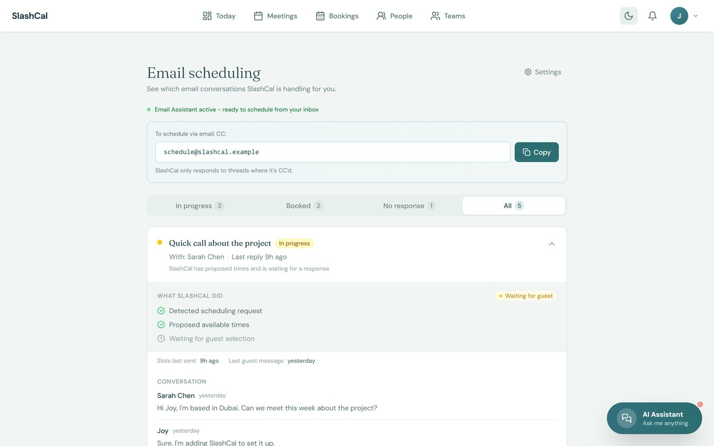
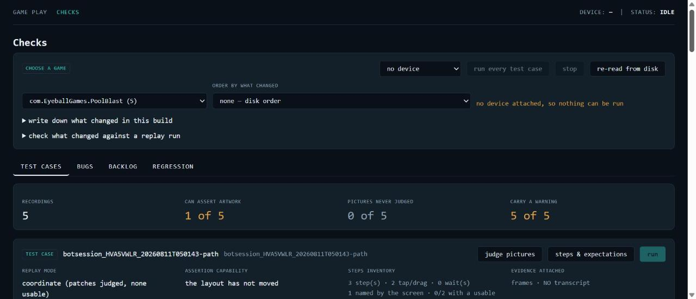
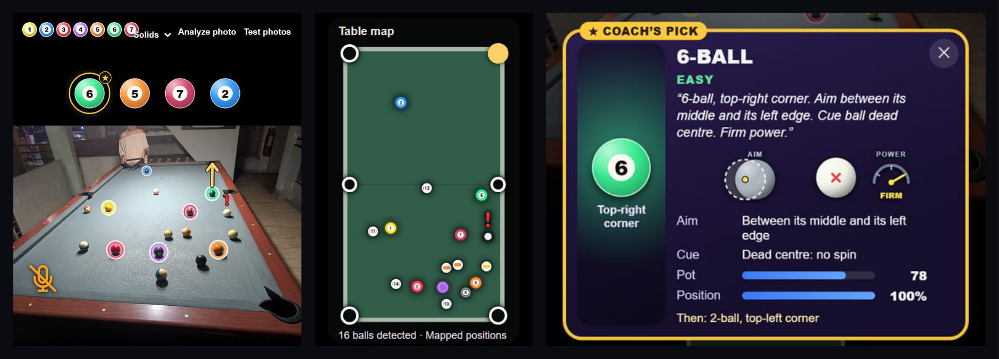

# Hi, I'm Joymie 👋

I build products end to end with vibe coding. I take an idea, plan it, build it, test it and launch it on my own.

I started in QA, where I learned how products break, and customer support, where I learned what frustrates users. Now I'm moving into product.

📍 Singapore · 💼 [LinkedIn](https://www.linkedin.com/in/joymie-l-4a765024b)

---

## What I built

### 📅 SlashCal: AI scheduling assistant

**The problem:** Setting up a meeting takes a lot of back-and-forth emails.

**What it does:** You just CC SlashCal on the email. It checks everyone's Google or Outlook calendar, finds a time that works and sends the invite.

- Came up with the idea, planned the first version, then built, tested and launched it on my own
- The AI reads the replies in the thread and works out what each person is asking for
- I chose email on purpose, so people don't have to learn a new app

👉 [Try the interactive walkthrough](https://slashcal-showcase-production.up.railway.app)

### ✅ Verdict: QA tool for mobile games

**The problem:** Testing every build by hand was slow. With the team in different timezones, developers had to wait for me before pushing.

**What it does:** It plays the game on a real Android phone by itself and tells you if the build is good, broken or couldn't be tested, with screenshots as proof.

- Built it so developers can run it themselves, anytime
- Used it to find Pool Blast levels that were too hard to win, and suggested fixes
- Ran it on 8 live games from the Play Store to prove it works on real apps

### 🎱 IRL Pool Coach: AI on Ray-Ban Meta glasses

Built the computer vision for a pool coaching app at Eyeball Games. It finds every ball on the table through the glasses' camera and suggests the next shot.

- Trained my own ball detection model (YOLO11), about 90% of balls found with no false detections
- Set a rule before training: a new model only goes live if it does better than the old one

👉 [See how it works](https://joy52-cyber.github.io/joymie-portfolio/poolcoach/)

---

## Other work

- 🎮 **Pool Masters:** owned QA from soft launch to worldwide release on Android and iOS
- 📺 **Netflix game:** wrote the spec for the phone controller and kept stakeholders updated until launch

## Tools I use

Claude · Cursor · Copilot · Python · JavaScript · React · Node.js · PostgreSQL · YOLO · GitHub Actions · Notion

> Most of my product code is private. Happy to walk you through any of it, just reach out on LinkedIn.
